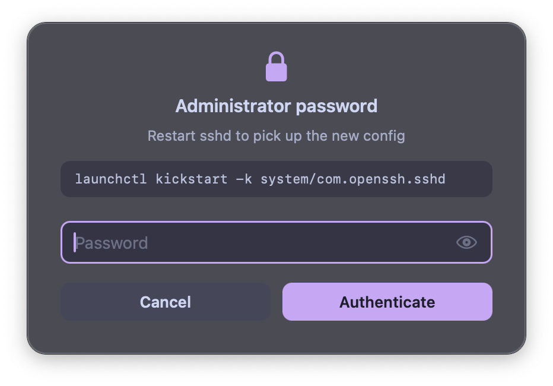
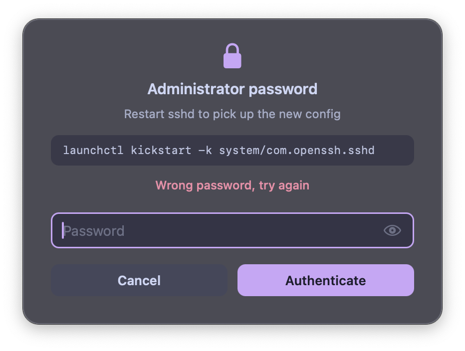
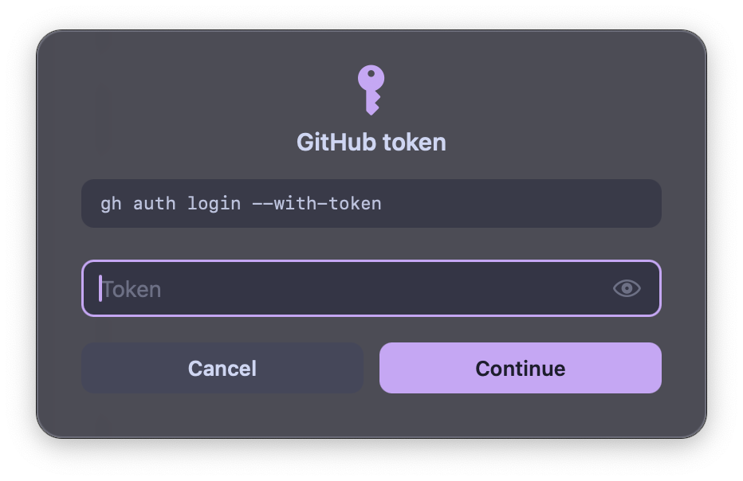
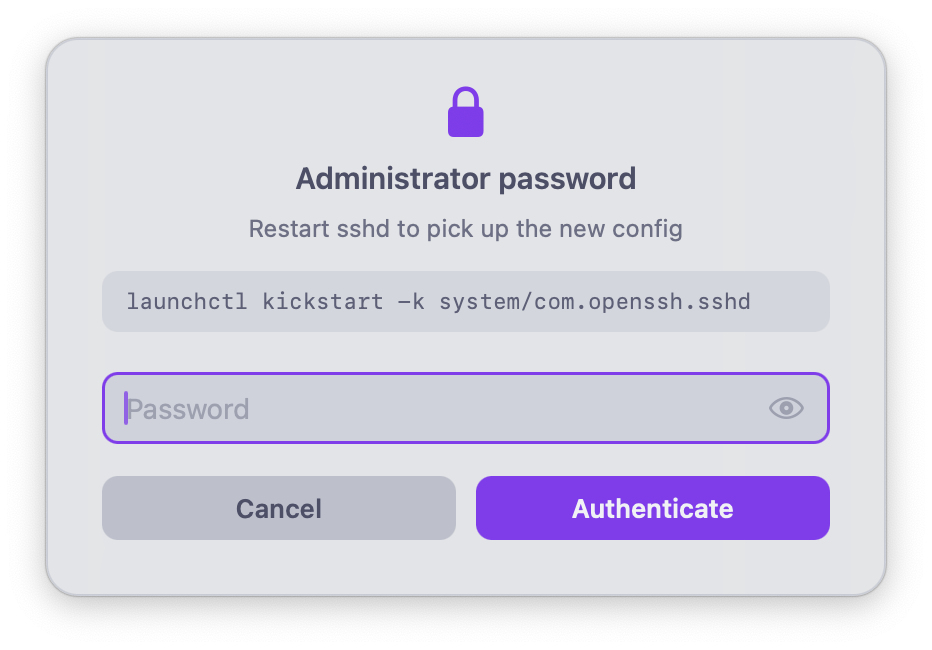

# secret-prompt

How does a coding agent run `sudo`, or log in with a token, without the password ending up in its transcript?

`secret-prompt` is a small macOS panel that asks **you** for the secret and hands it straight to the one command that needs it.
The agent sees the command run, never the value.
Two commands sit on top of it:

- `asudo` runs `sudo` with the password asked through the panel, showing why and exactly what will run.
- `with-secret` hands any other secret to a single command, as an environment variable or on stdin.

| `asudo` | wrong password |
| --- | --- |
|  |  |
| **`with-secret`** | **`theme = catppuccin-latte`** |
|  |  |

## Install

macOS 12 or later.

**Homebrew**

```sh
brew install theonewiththegun/tap/secret-prompt
```

**From source**, with the Xcode Command Line Tools:

```sh
git clone https://github.com/theonewiththegun/secret-prompt
cd secret-prompt
make install PREFIX=~/.local   # default /usr/local
```

**Nix**: the flake has `packages.default`, `overlays.default` and a home-manager module.

```nix
# flake inputs
secret-prompt.url = "github:theonewiththegun/secret-prompt";

# home-manager
imports = [inputs.secret-prompt.homeManagerModules.default];
programs.secret-prompt = {
  enable = true;
  theme = "system";
  colors.accent = "#89B4FA";
};
```

## Usage

```sh
asudo --reason "Restart sshd to pick up the new config" -- launchctl kickstart -k system/com.openssh.sshd

with-secret --env GH_TOKEN --title "GitHub token" -- gh repo list
with-secret --stdin --title "GitHub token" -- gh auth login --with-token
```

- **Return** submits, **Escape** cancels, **⌘⇧H** or the eye shows what you typed.
- A wrong sudo password brings the panel back with "Wrong password, try again", for sudo's usual three attempts.
- Cancel never runs the command: `asudo` gets sudo's `no password was provided`, and `with-secret` says `cancelled, <cmd> was not run` and exits 1.

`secret-prompt` on its own prints the secret to stdout.
That is how the two commands use it, and it is also exactly what an agent must not run, since its stdout is the agent's transcript.

## Agent setup

Tell the agent which commands to use, for example in `~/.claude/CLAUDE.md` or `AGENTS.md`:

```markdown
- Need root: `asudo --reason "<why, in a few words>" -- <command>`.
- Need any other secret: `with-secret --env VAR --title "<what it is>" -- <command>`, or `--stdin` to feed it on stdin.
- Never run `secret-prompt` on its own: it prints the secret into your output.
- Never ask for a password or token in chat.
```

And back the last-but-one rule with a permission rule, so a mistake is refused rather than shown.
In Claude Code's `~/.claude/settings.json`:

```json
{ "permissions": { "deny": ["Bash(secret-prompt:*)"] } }
```

The rule is a prefix match: it refuses `secret-prompt ...` and `x=$(secret-prompt ...)`, not a call by full path, so the instruction comes first and the rule is the backstop.

## Theming

The panel reads `~/.config/secret-prompt/config` (or `$XDG_CONFIG_HOME/secret-prompt/config`, or the file named by `$SECRET_PROMPT_CONFIG`):

```ini
theme = system        # catppuccin-mocha (default), -macchiato, -frappe, -latte, or system
accent = #89B4FA      # any role, #RRGGBB or #RRGGBBAA
opacity = 0.55        # how strongly the background tints the blur
```

The roles are `background`, `surface`, `raised`, `muted`, `subtext`, `command`, `text`, `accent` and `error`.
[`examples/config`](examples/config) says what each one paints.
`secret-prompt --dump-theme` prints the palette in effect, in the same format, so it can seed the file.

A bad line is a warning on stderr and that one key falls back, not an error: a typo in a color must never be the reason a sudo prompt does not appear.

## What it guarantees

- **Not in argv.** `--env` puts the value in one process's environment, and `--stdin` pipes it from a shell builtin rather than through a here-string, which bash may back with a temp file.
- **Not readable by keyloggers**, even while the value is revealed: the panel holds secure event input for as long as it is open.
- **Not on screen recordings.** The panel is excluded from screenshots and screen sharing (`SECRET_PROMPT_CAPTURABLE=1` lifts that, for taking screenshots like the ones above).
- **The command is shown before it runs**, re-quoted for reading, so approving it is a decision rather than a reflex.
- **A crash fails the caller**, rather than leaving an invisible panel that sudo waits on forever.

How it does each of those is in [docs/design.md](docs/design.md).

## License

MIT
